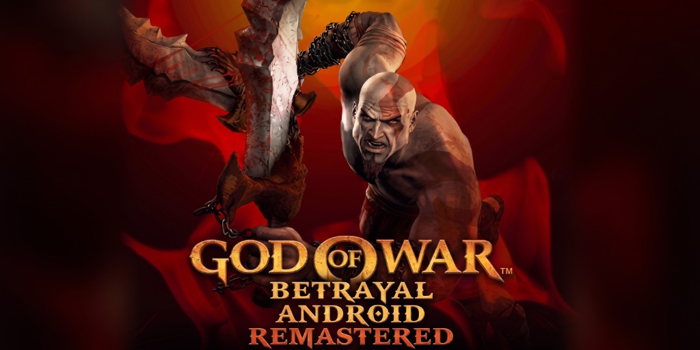

# God of War: Betrayal — Native Android Port

A native Android C++ port of *God of War: Betrayal*, forked from [samioan's Windows C++ port](https://github.com/samioan/gow-betrayal-remastered). Rebuilt from the decompiled bytecode of the Sony Ericsson K800i release (MIDlet 1.4.20) — running natively on Android with touch controls, gamepad support, high refresh rates, and widescreen.

---

## 📱 Features

- ⚔️ **Touch Controls**: On-screen virtual buttons designed for mobile play, with multi-touch support and smooth fade-out during inactivity.
- 🎮 **Controller Support**: Full support for Bluetooth and USB gamepads. The touch overlay automatically hides when a controller is connected.
- ⚡ **High Refresh Rates (60 / 90 / 120 FPS)**: Motion interpolation matching your screen's refresh rate while keeping the original 25 TPS logic speed.
- 🎵 **Optimized Audio**: Low-latency multithreaded audio engine.
- 📊 **FPS and TPS Counter**: Toggleable in the Options menu to monitor rendered FPS and logic ticks per second.
- 📁 **External Files & Saves**: Stores game saves, settings, and logs in the `GOW-Betra/` folder on your storage, with automatic fallback to internal storage.
- 🌐 **Widescreen & Multi-Language**: Widescreen support without stretching sprites, and fix for the original language selection bug.

---

## 📦 Download

Download the latest `.apk` from the **[Releases](https://github.com/SupaRj/gow-betrayal-remastered-Android-Native-port/releases)** page and install it on your Android device.

*Note: The original game assets belong to their respective copyright holders and are included (I don't make any money from this project. It's purely for preservation, and the game is simply no longer available to buy legally today.).*

---

## 📂 Repository Structure

| Path | Contents |
|---|---|
| `android/` | Android project (Gradle, CMake, SDL2 bindings, AndroidManifest, icons) |
| `android/app/src/main/cpp/` | Native Android glue (`main_android.cpp`, `platform_android.cpp`, touch controls) |
| `android/app/src/main/java/` | Java audio player (`GowMidiPlayer.java`) and SDL activity |
| `betrayal/port/` | The original C++ port and Win32 launcher |
| `betrayal/src/` | Renamed, compile-checked Java sources |
| `tools/` | Extraction, decompilation, renaming, and translation scripts |

---

## ⚖️ Legal & Attribution

- Original reverse-engineering and Windows C++ port by [samioan](https://github.com/samioan/gow-betrayal-remastered).
- Android Native Port, touch controls, audio optimization, and storage subsystem by [SupaRj](https://github.com/SupaRj/gow-betrayal-remastered-Android-Native-port) & Gemini 4 Argon.
- **AI Disclosure**: This project was developed with the assistance of AI and is not 100% human-made.
- This project is an independent educational preservation effort. It is not affiliated with, endorsed by, or supported by Sony Interactive Entertainment, Santa Monica Studio, Glu Mobile, or Metaflow. *God of War* is a registered trademark of Sony Interactive Entertainment LLC. See [NOTICE.md](NOTICE.md) for attribution and third-party licenses.
